<div align="center">

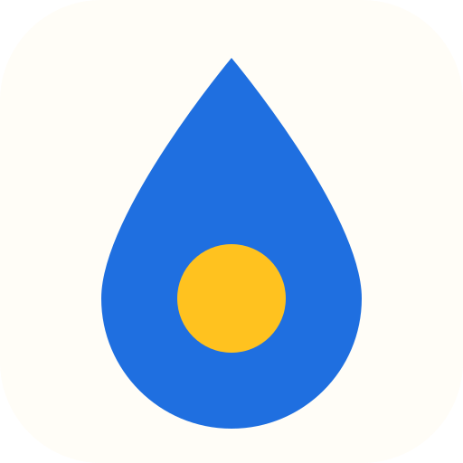

<h1>Gota a Gota</h1>

<p><strong>O depois do poço: água, horta e renda para as famílias do semiárido potiguar.</strong></p>

<p>FIAP &middot; Global Solution &middot; CitizenTech</p>

<p>
  
  
  
  
  
  
  
</p>

<p>
  <a href="#vídeo-pitch">Pitch</a> &middot;
  <a href="#ficha-da-citizentech">Ficha</a> &middot;
  <a href="#o-app-em-imagens">Imagens</a> &middot;
  <a href="#as-partes">As partes</a> &middot;
  <a href="#como-rodar-tudo">Como rodar</a> &middot;
  <a href="#rotas-da-api">API</a> &middot;
  <a href="#fonte-dos-preços">Preços</a> &middot;
  <a href="#princípios-de-design">Design</a> &middot;
  <a href="#equipe">Equipe</a>
</p>

</div>

---

Plataforma para comunidades rurais do semiárido do Rio Grande do Norte que receberam um poço
(inspirada no projeto Leve Poços, Comunidade Angélica, Ipanguaçu/RN). O app cuida do "depois do poço":
mostra o estado da água, orienta a horta, ensina a plantar e a vender, mostra o preço mínimo de venda
e conecta as famílias aos compradores. A ONG que acompanha as comunidades vê a caixa d'água,
a bomba solar, a qualidade da água e a saúde da horta pelas câmeras.

## Vídeo pitch

<div align="center">
  <a href="https://youtu.be/a5cI6_gjImc">
    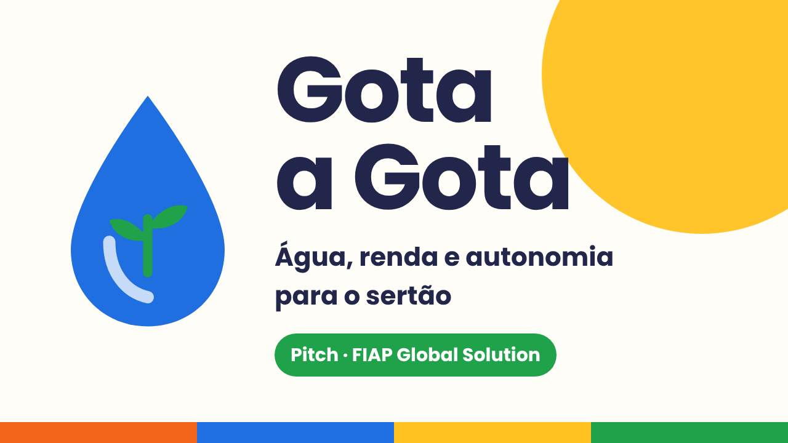
  </a>
  <br>
  <sub>Clique na imagem para assistir ao pitch no YouTube.</sub>
</div>

## Ficha da CitizenTech

| Campo | Informação |
| --- | --- |
| **Nome** | Gota a Gota |
| **Cidade / bairro** | Comunidade Angélica, Ipanguaçu (RN). As outras comunidades do painel da ONG são exemplos |
| **Cidadão beneficiado** | Famílias de comunidades rurais do semiárido potiguar que receberam um poço (donas de casa, agricultores) |
| **Problema em uma frase** | Depois que o poço chega, a família não sabe se a água está boa nem quanto ela dura, e não tem apoio para plantar e vender a horta por um preço que pague a bomba, então o poço deixa de se sustentar |
| **Como funciona** | Sensores na caixa d'água e na horta mandam leituras para uma API; o app mostra a água, orienta a horta, calcula o preço mínimo de venda e responde por voz com a Gotinha |
| **O que cada parte faz** | Veja [As partes](#as-partes) |
| **Repositório** | https://github.com/Arriatea/GS-CitzenTech |
| **Vídeo pitch** | https://youtu.be/a5cI6_gjImc |
| **Indicador de impacto** | Dias de água para beber garantidos na caixa (o app calcula a cada leitura) e renda mensal de cada família com a horta (colheitas registradas × preço mínimo) |
| **ODS** | ODS 6 (Água potável e saneamento), ODS 2 (Fome zero e agricultura sustentável) e ODS 8 (Trabalho decente e crescimento econômico) |

## O app em imagens

**No celular**, que é como a família usa:

<table>
  <tr>
    <td align="center" width="20%">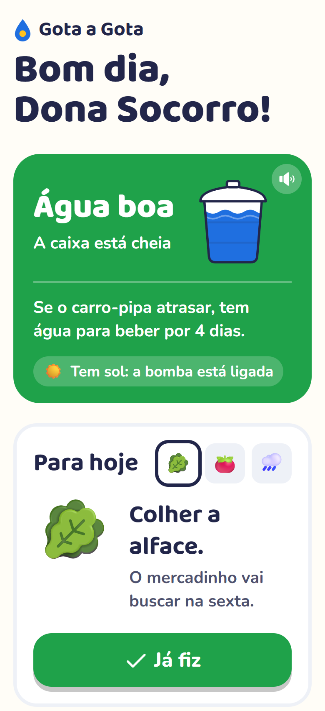<br><b>Início</b><br><sub>A água e a tarefa do dia</sub></td>
    <td align="center" width="20%">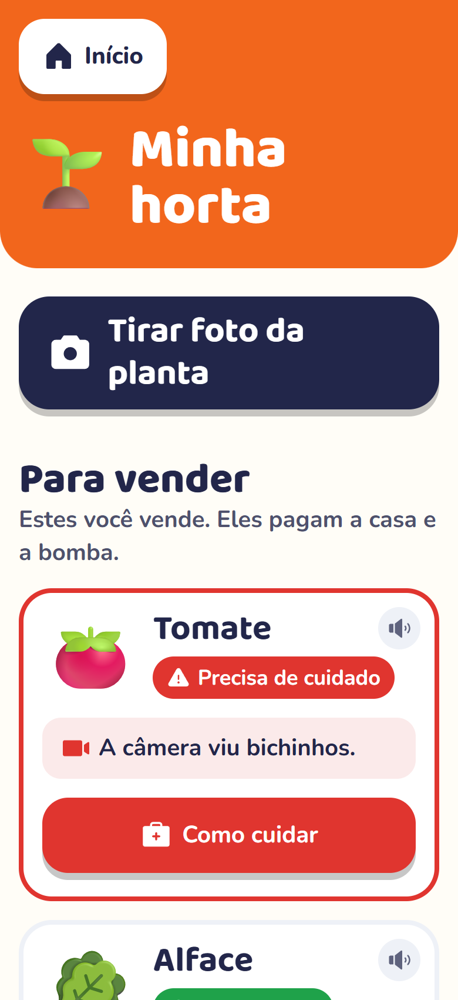<br><b>Minha horta</b><br><sub>O que precisa de cuidado primeiro</sub></td>
    <td align="center" width="20%">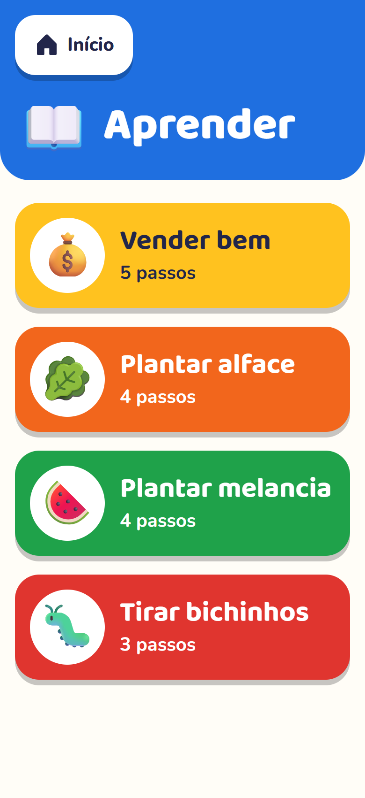<br><b>Aprender</b><br><sub>Aulas em poucos passos</sub></td>
    <td align="center" width="20%">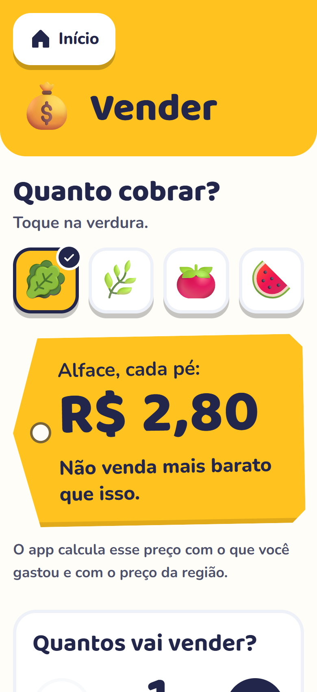<br><b>Vender</b><br><sub>O preço mínimo na plaquinha</sub></td>
    <td align="center" width="20%">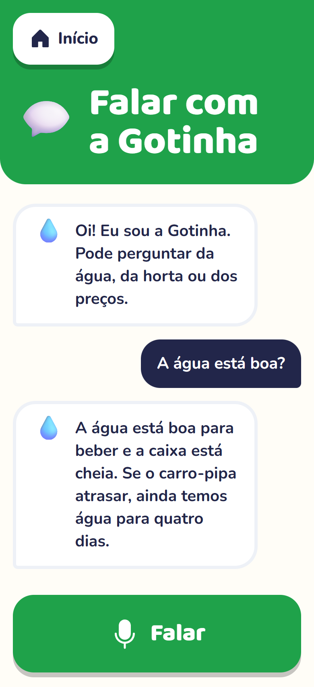<br><b>Gotinha</b><br><sub>Pergunta e resposta por voz</sub></td>
  </tr>
</table>

**No computador**, que é como a ONG acompanha (e o app da família também se abre na tela larga):

<table>
  <tr>
    <td align="center" width="50%">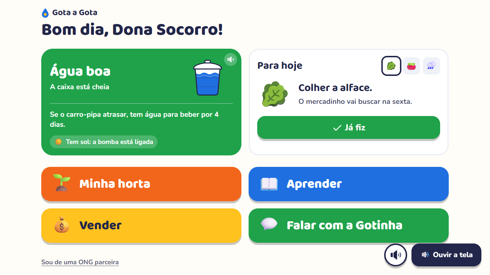<br><b>Início na tela larga</b><br><sub>Água e tarefa lado a lado, botões em grade 2x2</sub></td>
    <td align="center" width="50%">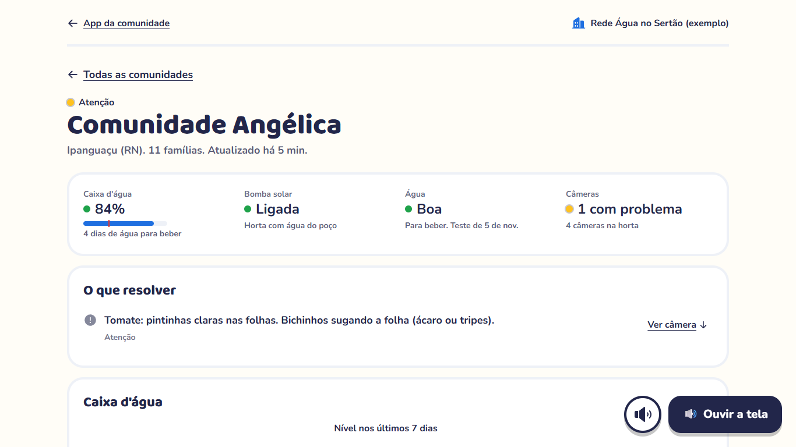<br><b>Área da ONG</b><br><sub>Os quatro indicadores e o que resolver na comunidade</sub></td>
  </tr>
</table>

**No Wokwi**, o ESP32 que simula os sensores da caixa d'água e da horta:

<div align="center">
  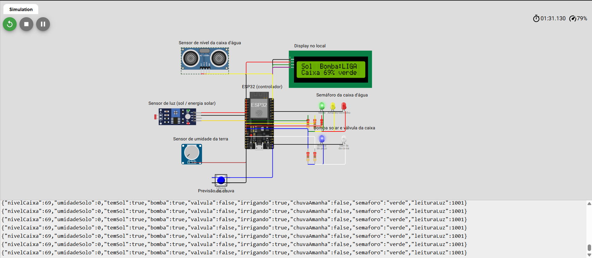
  <br>
  <sub>O display mostra o sol, a bomba e o nível da caixa; embaixo, as leituras em JSON que vão para a API.</sub>
</div>

## As partes

| Pasta | Parte | O que faz |
| --- | --- | --- |
| `src/`, `public/` e raiz | **Front** (React + Vite) | App da comunidade e área da ONG. Busca os dados na API e usa dados simulados se ela cair. |
| `backend/` | **API** (FastAPI) | Guarda o estado da água, recebe as leituras do ESP32, calcula o preço mínimo e conversa com a Gotinha. |
| `agente/` | **Gotinha** (Google ADK) | Assistente de voz. Responde sobre água, horta, preços, compradores e aulas usando as rotas da API. |
| `iot/` | **ESP32** no Wokwi | Simula a caixa d'água, a bomba solar, o sol, a umidade da terra e a previsão de chuva. |

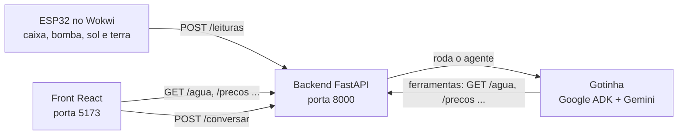

- **Front e água.** O front consulta a água a cada 5 segundos. Quando chega uma leitura nova, a tela Início
  muda sozinha e a audiodescrição avisa.
- **Front e Gotinha.** O front fala com a Gotinha por `POST /conversar`. O backend roda o agente, e as
  ferramentas dele consultam o próprio backend pelo endereço `GOTA_API_URL`. Se o Gemini estiver
  sobrecarregado, o backend tenta um modelo reserva (`gemini-flash-lite-latest`).
- **ESP32 e API.** O ESP32 manda a leitura para `POST /leituras` por Wi-Fi a cada 10 segundos (rede
  `Wokwi-GUEST`). O simulador do site do Wokwi não enxerga o `localhost`: ele envia para a API publicada
  (`API_LEITURAS`, no `iot/sketch.ino`). No computador, dá para simular a leitura com `curl` (exemplo em
  [Como rodar tudo](#como-rodar-tudo)).

## Como rodar tudo

Precisa de Node 20 ou mais novo e Python 3.12 ou mais novo. Use três terminais.

### 1. Backend

Fica em http://localhost:8000.

```bash
cd backend
python -m venv .venv
.venv\Scripts\activate            # no Linux/Mac: source .venv/bin/activate
pip install -r requirements.txt
cp .env.example .env              # preencha GOOGLE_API_KEY
uvicorn app.principal:app --reload --port 8000
```

| Variável (`backend/.env`) | Para quê |
| --- | --- |
| `GOOGLE_API_KEY` | Chave do Google AI Studio usada pela Gotinha dentro do app |
| `GOOGLE_GENAI_USE_VERTEXAI` | `FALSE` para usar a chave do AI Studio |
| `GOTA_API_URL` | Opcional. Endereço deste próprio backend, usado pelas ferramentas da Gotinha (sem ela, o backend usa o próprio endereço local) |
| `GOTINHA_MODELO_RESERVA` | Opcional. Modelo usado se o principal falhar (padrão `gemini-flash-lite-latest`) |

> [!NOTE]
> Sem a chave, tudo funciona, e a Gotinha responde "Não consegui responder agora, tente de novo."

### 2. Agente sozinho no ADK Web (opcional)

Fica em http://localhost:8080 e serve para testar a Gotinha fora do app.

```bash
cd agente
python -m venv .venv
.venv\Scripts\activate
pip install -r requirements.txt
cp gota_agente/.env.exemplo gota_agente/.env   # preencha GOOGLE_API_KEY; GOTA_API_URL=http://localhost:8000
adk web --port 8080
python testar_ferramentas.py                   # testa as ferramentas sem chamar a IA
```

### 3. Front

Fica em http://localhost:5173.

```bash
npm install
cp .env.example .env              # VITE_API_URL=http://localhost:8000
npm run dev
npm run build                     # versão final em dist/
```

| Variável (`.env` da raiz) | Para quê |
| --- | --- |
| `VITE_API_URL` | Endereço do backend |

Nenhum `.env` vai para o git.

### Simular uma leitura do ESP32

Com a caixa pela metade:

```bash
curl -X POST http://localhost:8000/leituras -H "Content-Type: application/json" \
  -d '{"nivelCaixa":45,"umidadeSolo":38,"temSol":false,"bomba":false,"valvula":true,"irrigando":true,"chuvaAmanha":true,"semaforo":"amarelo","leituraLuz":3100}'
```

### Testes do backend

```bash
cd backend
python -m pytest
```

## Publicar no Render

O `render.yaml` da raiz cria a API e o front de uma vez, no plano grátis:

1. No Render: **New > Blueprint** e escolha este repositório.
2. Preencha `GOOGLE_API_KEY` quando o Render pedir.
3. Se o endereço da API não for `https://gota-a-gota-api.onrender.com`, troque `VITE_API_URL` no serviço
   `gota-a-gota` (o front) e publique de novo, e troque `API_LEITURAS` no `iot/sketch.ino`.

> [!TIP]
> No plano grátis, a API "dorme" depois de 15 minutos sem uso e leva cerca de um minuto para acordar.
> Enquanto isso, o app mostra os dados simulados; a água volta a ser consultada a cada 5 segundos e as
> outras telas buscam de novo quando são abertas. Antes de apresentar, abra o `/saude` da API para acordá-la.

## Rotas da API

| Rota | O que faz |
| --- | --- |
| `GET /saude` | Confere se a API está no ar |
| `GET /agua` | Estado da água no formato do front |
| `POST /leituras`, `GET /leituras/ultima` | Recebe e mostra a leitura do ESP32; a leitura atualiza a água |
| `GET /tarefas`, `/canteiros`, `/cursos`, `/compradores`, `/impacto`, `/comunidades` | Dados das telas |
| `GET /precos`, `GET /precos/{cultura}` | Preço mínimo calculado, com o bloco `como_calculamos` |
| `POST /precos-locais`, `GET /precos-locais?cultura=alface` | Preços informados pelos comerciantes |
| `POST /colheitas`, `GET /colheitas` | Diário de colheitas (usado pela Gotinha) |
| `POST /conversar` | Conversa com a Gotinha: recebe `{sessao, mensagem}` e devolve `{resposta}` |

## Dados

> [!IMPORTANT]
> Tudo é **simulado**, menos a referência de preço de atacado da **Ceasa/RN (Natal)**.

A referência da Ceasa (`backend/dados/precos_referencia.json`) foi tirada do
[boletim diário de preços de mercado de 19/11/2026](https://transparencia.ceasa.rn.gov.br/cotacoes),
pelo preço mais comum. A melancia é cotada por quilo (R$ 2,50); para o preço de cada uma usamos 5 kg por
melancia, uma estimativa nossa.

São simulados: a água e as leituras, as tarefas, os canteiros, as aulas, os compradores, os preços dos
comerciantes, o custo de produção, as comunidades da ONG (as marcadas "(exemplo)" são fictícias), a análise
da foto tirada pela família e as ações da ONG. As fotos das câmeras são fotos reais de exemplo, com licença
livre (veja [Fotos das câmeras](#fotos-das-câmeras)). Os dados ficam em memória: reiniciar o backend volta
ao estado inicial.

## Fonte dos preços

O preço mínimo de cada cultura junta três referências:

| Referência | Arquivo / rota | Origem |
| --- | --- | --- |
| **Preço de atacado** | `backend/dados/precos_referencia.json` | Ceasa/RN, boletim diário de 19/11/2026 (consulta manual) |
| **Preço dos comerciantes locais** | `POST /precos-locais` (começa com registros simulados) | Mercadinho, escola, feira |
| **Custo de produção por unidade** | `backend/dados/custos_producao.json` (simulado) | Sementes, adubo e horas de trabalho por ciclo |

A regra fica em `backend/app/preco_minimo.py`:

| Situação | Preço mínimo |
| --- | --- |
| **Com comerciantes** | O maior valor entre custo por unidade × 1,3, a média dos comerciantes e o atacado da Ceasa |
| **Sem comerciantes** | O maior valor entre custo por unidade × 1,3 e o atacado da Ceasa × 1,2 |

O atacado da Ceasa funciona como **piso**: a família nunca vende abaixo do que o atacado paga.
A resposta de `GET /precos/{cultura}` mostra a conta no bloco `como_calculamos`. A leitura da referência
fica na classe `FonteDePrecoReferencia` (`backend/app/fonte_preco.py`), para trocar o JSON por uma API real
sem mexer no resto.

## Uso de IA

A Gotinha usa o Gemini pelo Google ADK (`agente/gota_agente/agent.py`), com um modelo reserva quando o principal
está sobrecarregado. Os prompts usados com ferramentas de IA no desenvolvimento estão em [prompts.md](prompts.md).

## Telas da comunidade

| Âncora | Tela | O que tem |
| --- | --- | --- |
| `#inicio` | **Início** | Caixa d'água desenhada com o nível, sol/bomba, uma tarefa do dia por vez e quatro botões grandes. |
| `#horta` | **Minha horta** | Foto da planta (resposta simulada) e canteiros, com o que precisa de cuidado primeiro e o aviso da câmera. |
| `#aprender` | **Aprender** | Lista de aulas (as terminadas aparecem como "Feita"). `#aprender/pulgao` abre direto uma aula. |
| `#vender` | **Vender** | Preço mínimo em formato de plaquinha de feira, a conta "quantos vai vender" e quem compra. |
| `#conversar` | **Falar com a Gotinha** | Botão de microfone (e campo de texto no computador ou sem microfone), perguntas prontas e balões; a resposta é lida em voz alta. |

No computador (a partir de 768px), o conteúdo se abre até 1200px: no Início, a água e a tarefa ficam lado a lado
e os quatro botões em grade 2x2; os canteiros, os cursos e os compradores ficam em grade; a aula fica numa coluna
central; e na Gotinha as perguntas prontas vão para o lado. No celular, nada muda.

## Área da ONG (`#parceiro`)

Para a ONG que acompanha as comunidades (público técnico, aqui pode ter números).

- **Uma ONG só.** O app atende uma única ONG: quem entra em `#parceiro` vê direto as comunidades dela.
  Não existe tela para escolher nem para trocar de ONG, e uma ONG não tem como ver os dados de outra.
  No sistema real, o login define a ONG e a API só devolve as comunidades dela.
- **Comunidades.** Agrupadas por situação (precisam de visita, atenção, tudo certo). Cada comunidade é uma linha
  com os mesmos quatro indicadores, sempre na mesma ordem (caixa d'água, bomba solar, água, câmeras), cada um com
  cor e palavra, e embaixo o que é preciso resolver nela, em poucas palavras.
- **Comunidade** (`#parceiro/angelica`):
  - No alto, os mesmos quatro indicadores e um bloco **O que resolver**, com cada item levando à parte certa da página.
  - **Caixa d'água**: nível, litros, reserva para beber, bomba solar (ligada, parada por falta de sol ou falha),
    de onde a horta tira água agora, último teste da água, gráfico dos últimos 7 dias com a linha de alerta
    e o que aconteceu (carro-pipa, dias sem sol, testes).
  - **Horta pelas câmeras** (as com problema primeiro): a última foto de cada câmera, com o quadrado onde a IA viu o problema e a certeza dela.
    Ações: "Enviar orientação à família" (a família recebe a aula no app) e "Marcar visita técnica".

As regras de alerta ficam em `src/pages/parceiro/situacao.js` (caixa abaixo de 30% é urgente, bomba que não liga
com sol, água fora do padrão, câmera com alerta ou sem sinal).

### Fotos das câmeras

As fotos em `public/cameras/` são **fotos reais de exemplo**, tiradas do Wikimedia Commons com licença livre
(CC0, CC BY, CC BY-SA ou domínio público). Não foram tiradas nas comunidades. O crédito (autor, licença e link)
aparece embaixo de cada foto e está em `creditosFotos`, em `src/data/mock.js`. No sistema real, cada quadro
mostra a última foto enviada pela câmera da horta.

## Princípios de design

Quem usa o app da comunidade são donas de casa e trabalhadores rurais, muitos com pouca leitura e pouco
contato com tecnologia.

| Princípio | Como aparece no app |
| --- | --- |
| **Uma coisa por tela** | Sem menu escondido, sem gráfico, sem porcentagem e sem termo técnico. |
| **Figura antes de texto** | A caixa d'água é desenhada com o nível; as tarefas do dia aparecem em fila com as figuras. |
| **Cor e palavra juntas** | Todo estado tem cor e texto ("Pode colher!", "Precisa de cuidado"), nunca só cor. |
| **Tocar para ouvir** | Todo cartão de informação lê em voz alta quando é tocado; o alto-falante pequeno no canto é sempre o mesmo sinal. |
| **Falar em vez de escrever** | A Gotinha ouve a pergunta pelo microfone e responde em voz alta. |
| **Perdoar o erro** | A tarefa marcada sem querer volta tocando na figura dela na fila. |
| **O app faz a conta** | Em Vender, o "−" e o "+" dizem quanto cobrar no total. |
| **Lembrar** | Tarefas do dia e aulas feitas ficam guardadas no aparelho. |
| **Sinal fraco** | Depois da primeira visita, o app abre sem internet (`public/sw.js`), e sem a API usa os dados simulados. |

**Audiodescrição em todo o app.** Cada tela tem um texto que diz o que tem nela e onde tocar
(`useDescricao` em `src/lib/AudioDescricao.jsx`). Ele é lido sozinho quando a tela abre (depois do primeiro
toque, que o navegador exige) e pode ser repetido no botão "Ouvir a tela". O botão redondo liga e desliga
a leitura automática. A leitura usa a voz mais natural que o navegador tiver e fala uma frase por vez
(`src/lib/voz.js`). Se o aparelho não tiver voz, tudo continua funcionando.

Também: foco visível no teclado, `prefers-reduced-motion` respeitado e emojis decorativos escondidos dos
leitores de tela.

**Stack do front:** React 19, Vite, Tailwind CSS v4 (tokens com `@theme static` em `src/index.css`) e ícones
Phosphor (`react-icons/pi`). Sem biblioteca de rotas: a navegação usa a âncora da URL (`#tela` ou `#tela/detalhe`).

## Estrutura

```
src/
  App.jsx                    navegação por âncora + AudioDescricaoProvider + BotaoAudio
  main.jsx, index.css        entrada, tokens visuais e registro do modo sem internet
  data/mock.js               dados simulados (reserva quando a API não responde)
  lib/api.js, lib/useApi.js  chamadas à API com reserva no mock.js
  lib/voz.js                 falar(), calar(), podeFalar() com speechSynthesis e escolha da voz
  lib/AudioDescricao.jsx     contexto da audiodescrição e hook useDescricao
  lib/guardar.js             guardar no aparelho (localStorage) e vibrar
  components/                Topo, BotaoAudio, CaixaDagua, CartaoFalante, Carregando
  pages/                     Inicio, Horta, Aprender, Vender, Conversar, Parceiro
  pages/parceiro/            Comunidades, Comunidade, GraficoNivel, QuadroCamera, situacao.js
public/                      sw.js, manifest, ícone e fotos das câmeras
backend/
  app/                       rotas, cálculo do preço mínimo, FonteDePrecoReferencia e Gotinha
  dados/                     referência da Ceasa, custo de produção e preços dos comerciantes
  dados_iniciais.json        dados simulados iniciais
  tests/                     testes com pytest
agente/gota_agente/          Gotinha: agent.py (instrução) e ferramentas.py (chamadas à API)
iot/                         sketch.ino (envia as leituras por Wi-Fi), diagram.json e libraries.txt do Wokwi
docs/                        capa do vídeo pitch e capturas de tela usadas neste README
render.yaml                  publicação no Render (API e front)
prompts.md                   registro do uso de IA
```

## Licença

MIT. Veja [LICENSE](LICENSE).

## Equipe

Cinco integrantes, com foto e perfil no GitHub.

| Foto | Nome | GitHub |
|:---:|---|---|
|  | **Ana Clara** | [@Olivanaa](https://github.com/Olivanaa) |
|  | **Kaike Sousa** | [@kaike-sousa](https://github.com/kaike-sousa) |
|  | **Marco Aurelio** | [@arriatea](https://github.com/arriatea) |
|  | **Vitor Alcantara** | [@VitorAlcantara-tech](https://github.com/VitorAlcantara-tech) |
|  | **Vitor Fernandes** | [@Vitor-1Fernandes](https://github.com/Vitor-1Fernandes) |

---

<p align="center"><sub>FIAP GLOBAL SOLUTION CITIZEN TECH</sub></p>
